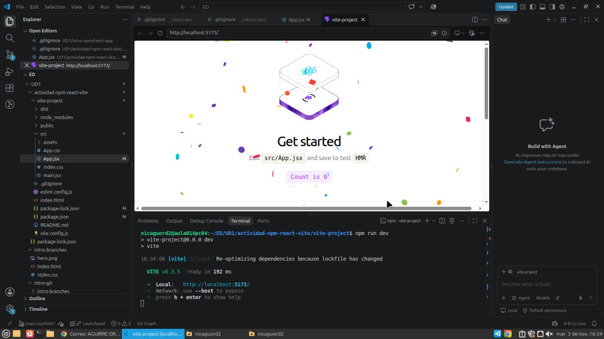
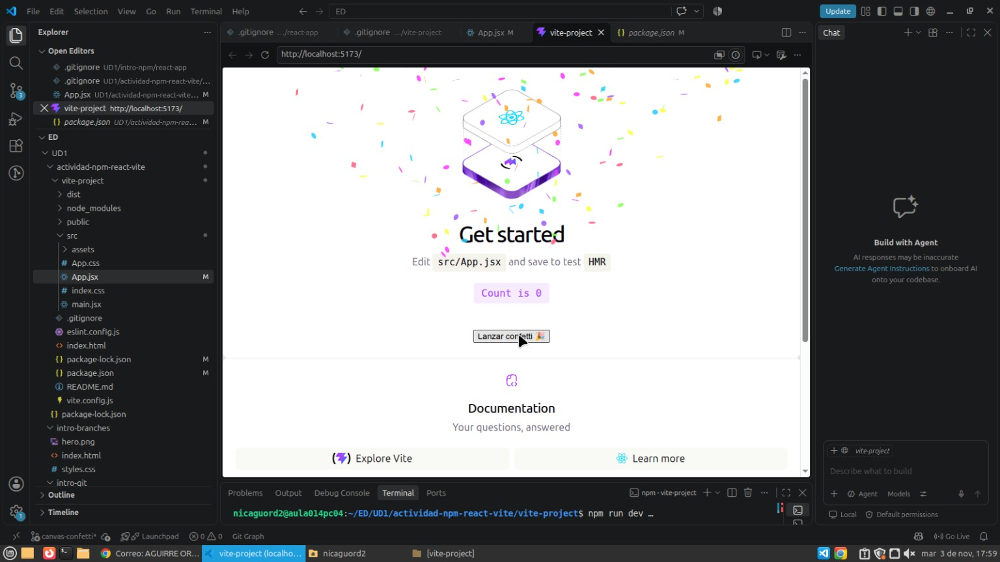
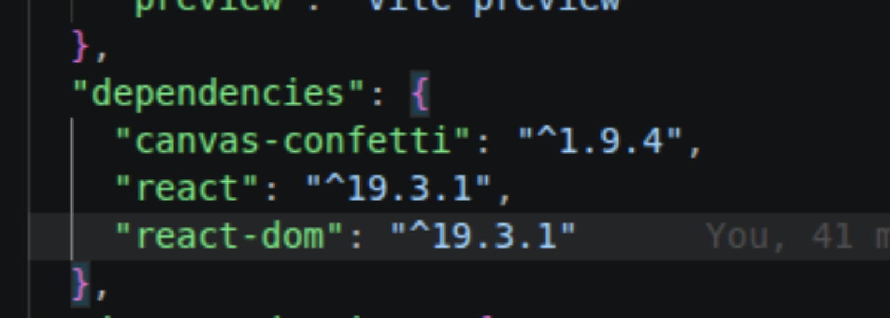
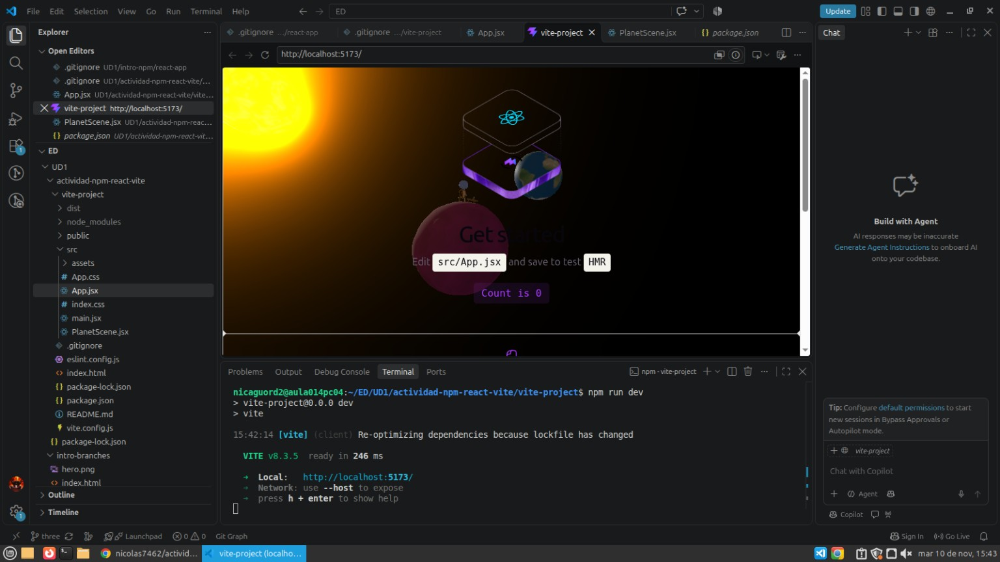

# Actividad React, Vite y Git

## Descripción

En esta actividad hemos creado una aplicación web utilizando React y Vite. Hemos trabajado con npm para instalar dependencias y con Git para crear ramas, realizar commits y resolver conflictos.

## 1. React Confetti

En la rama `react-confetti` instalamos la dependencia `react-confetti` para mostrar confeti automáticamente al cargar la página.

## 2. Canvas Confetti

En la rama `canvas-confetti` instalamos la dependencia `canvas-confetti` y añadimos un botón que lanza 150 partículas de confeti al pulsarlo.

### Dependencia en package.json

## 3. Escena 3D con Three.js

En la rama `three` añadimos el componente `PlanetScene.jsx` y el modelo `EscenaMain-Rig.glb`, utilizando la biblioteca Three.js para representar una escena 3D animada.

## 4. Ramas y merges

Hemos trabajado con cuatro ramas:

- `main`
- `react-confetti`
- `canvas-confetti`
- `three`

Elegimos `canvas-confetti` para integrarlo en `main`. Después hicimos el merge de la rama `three` y resolvimos el conflicto de `App.jsx`, conservando ambos componentes.

## 5. Pregunta teórica

### Si la carpeta node_modules/ está excluida, ¿borrar una dependencia hace alguna acción sobre el repositorio? ¿Cuál?

Sí, si eliminamos una dependencia mediante `npm uninstall`, npm modifica los archivos `package.json` y `package-lock.json`, que están incluidos en el repositorio Git.

Aunque la carpeta `node_modules/` está excluida mediante `.gitignore`, Git detecta los cambios realizados en esos dos archivos.

Para guardar esos cambios en el historial del repositorio debemos realizar un commit.

## 6. Web desplegada

La aplicación se ha compilado con `npm run build` y se ha publicado en GitHub Pages.

**Enlace a la web:** https://nicolas7462.github.io/actividad-npm-react-vite-web/

**Repositorio del despliegue:** https://github.com/nicolas7462/actividad-npm-react-vite-web

La versión publicada incluye el botón de confeti y la escena 3D realizada con Three.js.